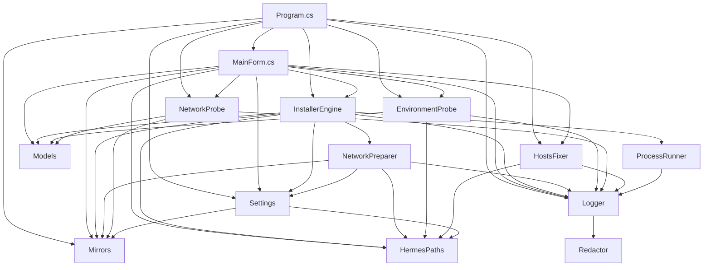

# Hermes Update — 项目技术地图

> 面向 agent 的项目速览。用户文档见 `README.md`。
> 本文所有数字取自 **2026-10-25 `codegraph` 全量索引实测**（codegraph 1.6.0 / extraction 25 / `index_state=complete`）：**E12 修复后 23 个 C# 文件 / 9,157 行（`splitlines` 口径，排除 bin/obj）/ 902 节点 / 2,653 边 / DB 3.14MB**。改代码后先 `codegraph sync`，再用 `codegraph status` 复核，最后回来改这里被影响的数字。
> **口径互斥时以本节为准**：规模看 `codegraph status`（或 `select count(*) from files`），不看 `project_metadata.index_files_discovered`（`sync` 不写回该字段，会停在最后一次全量索引的值）。行数口径是 `splitlines`（`HostsFixer.cs` 结尾无换行，`wc -l` 会少算 1 行）。符号数口径是 `codegraph files` 输出的 `node_count`（含该文件的 file/namespace/import 节点）。

## 1. 项目定位

Windows 平台的 **Hermes Agent / Hermes 桌面端** 安装与升级工具（非官方，社区维护）。
单文件 WinForms，目标框架 **.NET Framework 4.8**（Win10/11 自带，无需额外运行时）。

## 2. 技术栈

| 项 | 值 |
|---|---|
| 语言 | C#（csproj 为 `LangVersion=latest`，但现有代码实测全是 C# 5/6/7 风格：`$"..."` 插值 **0 处**、`?.` **0 处**、`nameof(` **0 处**、无 record / switch 表达式；字符串一律 `string.Format` + 拼接——新代码照此风格写） |
| 目标框架 | `net48`（`src/HermesInstaller/HermesInstaller.csproj`） |
| UI | WinForms 单窗体（`MainForm.cs`，`UseWindowsForms=true`） |
| 编译期引用 | 仅 3 个 BCL 程序集：`System.Web.Extensions`（`JavaScriptSerializer` 解 install.ps1 的 JSON）、`System.Runtime.Serialization`（`DataContractJsonSerializer` 存配置/安装戳）、`System.Net.Http` |
| 平台 | `AnyCPU`、`Prefer32Bit=false`、`CodePage=65001`、`Nullable=disable` |
| 项目风格 | **SDK 风格、无 `<Compile Include>` 清单**（csproj 31 行）：新增 `.cs` 自动参与编译，不需要登记；资源靠 `Resources/` 下的 `ApplicationManifest` / `ApplicationIcon` 属性挂 |
| 构建 | `pwsh -File .\build\build.ps1`（`dotnet build -c Release` → 拷 exe/exe.config/README/LICENSE/NOTICE 到 `dist/HermesInstaller` → `Compress-Archive` 打 zip） |
| 产物 | `dist/HermesInstaller/HermesInstaller.exe`、`dist/HermesInstaller-win-x64.zip` |
| 依赖 | 无第三方 NuGet；仅 BCL + PowerShell 子进程 |

## 3. 目录结构（括号内为 行数 / 符号数 / 被依赖文件数）

行数按 `splitlines`，符号数按 `codegraph files`（含 file/namespace/import 节点）；**E7 升级预热交付后 23 个文件合计 7,831 行 / 856 节点**。扣掉 file/namespace/import 后的真实声明：method 279、property 160、field 115、class 51、constant 28、enum 8、enum_member 44。

**M1（2026-10-24）新增的 7 个 Core 文件（共 2,060 行 / 214 符号）**——下列目录树为 M1 前的结构，新文件已并入 `Core/`：

| 文件 | 行数 | 符号 | 职责 |
|---|---|---|---|
| `Core/RetryPolicy.cs` | 169 | 25 | 九类操作超时/重试/退避参数表 + `ProcessRunOptions` |
| `Core/ResultVerifier.cs` | 657 | 58 | A1–A5 五项断言、`VerificationReport`、三态合成；另含 `ServiceEntry`/`ServiceSnapshot`/`ServiceRestoreResult`。E9-1：A1 CLI 版本断言由 `^v?\d+\.\d+` 整串锚定改为非锚定语义版本段搜索。E9-2：三态 Summary 去掉自嵌的前缀「失败：/降级完成：」，前缀统一由 `UiTextBuilder.OutcomeTitle` 提供（修复「降级完成：降级完成：」重复文案；Success Summary 去硬编码「升级完成」）。E10-②：A2 改级联探测（tools → installs venv，CollectVenvPythons 定向三层枚举）+ 解释器锁定 `_lockedPython`（操作前后同一核探体）。E10-①：新增 A5 升级欠账断言（VerifyAsync 新参数 owedMarkers）。E11：A3 判据从「本轮操作是否碰过产物」改为「产物是否晚于当前代码同步时刻（HEAD 提交时间，`_engine.GetHeadCommitTimeAsync`）」，git 时间不可用时退回本轮 mtime——修复「版本未变 + G3 跳过重建 → A3 必然误报失败」的 13:01 事故 |
| `Core/VersionFingerprint.cs` | 228 | 30 | gitHead + lockSha256 + cliVersion 三元组采集/判等/落盘 |
| `Core/HomeRegistry.cs` | 272 | 27 | 三个候选数据根枚举 + 去重 + 进程按根归属 |
| `Core/ServiceStateGuard.cs` | 343 | 21 | 网关状态快照与 `ensure → start → 降级` 复原（含双起防护） |
| `Core/RunStateStore.cs` | 379 | 40 | `state\run.json` 生命周期，供第二实例读取进度 |
| `Core/UiTextBuilder.cs` | 145 | 14 | 结论/断言行/多根摘要等文案生成（不引 WinForms） |

**既有文件符号数变化**（M1 后）：`InstallerEngine` 42→52、`ProcessRunner` 25→38、`Models` 89→97、`HermesPaths` 26→30、`MainForm` 102→103。`MainForm.cs` 行数 1,310→**1,345**（NFR-09 预算 ≤1,355）。

**E7（2026-10-25）新增的 1 个 Core 文件（升级预热）**：

| 文件 | 行数 | 符号 | 职责 |
|---|---|---|---|
| `Core/DependencyPrefetcher.cs` | 942 | 46 | E7 依赖预热：按「升级子进程将使用的 ELECTRON_MIRROR」解析缓存键 sha256(base+"v"+版本)，把 Electron 运行时 zip 预下载进 `%LOCALAPPDATA%\electron\Cache`（`@electron/get` 2.x 与本机实测键 0a74c7b0…/902aaaf9… 对齐）；版本候选 = git show upstream/main:package-lock.json（失败回退 origin）→ 本机 package-lock.json → node_modules\electron\package.json；校验源 = 本机 electron 包 checksums.json（版本一致时）→ npmmirror SHASUMS256.txt，拿不到按「未校验」落位。下载 15 分钟预算，best-effort 只 Warn 不阻塞升级。**E8 追加 fork 预同步（`PreflightForkSyncAsync`）**：把 upstream/main 预先 push 到 origin（命令与 hermes `update_cmd_git.py _sync_fork_with_upstream` 逐字一致 + 同口径 merge-base 祖先护栏），显式注入 `GIT_ASKPASS=echo`/`GCM_INTERACTIVE=never`/`GIT_HTTP_LOW_SPEED_*` 防凭证等待挂死；成功后 update 的 Syncing fork 步骤直接跳过。**E10-③ 三件套**：① 修复 `ResolveCacheRoot` 盘根 bug（HermesPaths.LocalAppDataRoot=GetPathRoot → C:\electron\Cache，预热一直写到平行宇宙从未被命中；改用 SpecialFolder.LocalApplicationData 真根）；② 双键种子 `SeedAlternateBaseKey`：主键之外再种 GitHub 官方基址键，同卷 `CreateHardLink`（P/Invoke）0 冗余、失败复制回退（11:15 实测 env 流转断掉时 install.js 走 GitHub 直连，需两种键都在真根）；③ builder 工具集预热 `WarmBuilderToolsetsAsync`：依据 npm tarball 考古（app-builder-lib 26.18.0 electronGet.js）实锤 downloadBuilderToolset 的 archive cache 公式 `<cacheRoot)\<releaseName>\<filenameWithExt>`、winCodeSign 走 legacy `.7z`（极效官方 sha256 cdaec715…）、.7z 解压需 `7zip@1.0.0/7zip-win-x64.tar.gz`（sha256 be071f15…），npmmirror 实测 200 OK；双根落位（ELECTRON_BUILDER_CACHE env 目标 + `%LOCALAPPDATA%\electron-builder\Cache` 默认根）。**E12-③/④**：`DownloadAndPlaceAsync` 的 body 改分块读 + `CopyWithWatchdogAsync`（60s 无进展判僵死、总预算、15s 进度日志），返回实测速率供 planner 判降级；新增 `TryAdoptFromAlternateKey` 跨键复用（任一基址键已有且校验通过即硬链接，零重下） |

**既有文件相关变化（E8 后）**：`NetworkPreparer.cs` 79→190 行、12→18 符号（E7 新增 `ResolveElectronBase()` 公开方法，与 `BuildEnvironment` 同路解析 `EndpointGroup.Electron`；E8-4 `BuildEnvironment` 又追加 5 个 git 防挂死变量 `GIT_TERMINAL_PROMPT=0` / `GCM_INTERACTIVE=never` / `GIT_ASKPASS=echo` / `GIT_HTTP_LOW_SPEED_LIMIT=1000` / `GIT_HTTP_LOW_SPEED_TIME=30`——本机 credential.helper=manager 下 fork 推送会静默等 GUI 凭证，注入后 git 子进程禁止交互并把卡死连接 30 秒自弃）；`Mirrors.cs` 119→171 行、22→24 符号（E8-2 把 electron-0 / builder-0 两个 L0 端点补全 `releases/download/` 尾缀：`@electron/get` 与 electron-builder 对 base URL 均为零修正拼接，L0 直连缺尾缀必 404）；`InstallerEngine.cs` 580→914 行（E7 在 CLI 检查之后、停进程之前插入预热调用；E8 update 阶段改用专用放宽预算 `NoProgressTimeout=15min / TotalTimeout=45min`（D-15：原 OperationBudget 180s 无进展预算会误杀 fork 同步推送与 desktop 打包的合法静默段），退出非零但指纹 `gitHead` 已推进时补偿复跑一次 update（D-16：hermes 把未完收尾记为 owed、下次 update 自动补完，故"退出非零 ≠ 升级失败"），并新增 `ShortSha()` 小助手）。

**既有文件相关变化（E9 后）**：`ResultVerifier.cs` 524→510 行（此前行数记录为陈旧值；E9-1 A1 版本断言锚定放宽 + E9-2 三态 Summary 前缀收口，见 M1 表该行）；`UiTextBuilder.OutcomeTitle` Degraded 分支改为 `"{操作名}降级完成"`；`DependencyPrefetcher.cs` `GitStdOutAsync` 修复"引号路径与参数粘连少空格" bug（E9-0：`-C "路径"rev-parse` 必然失败 → 曾把已存在的 upstream/main 误报为"无引用"而跳过预同步；11:15 冒烟验证修复后预同步真实执行——push 以"无凭证 Repository Not Found"3 秒快速失败并继续，符合设计）。

**既有文件相关变化（E10 后，2026-10-25 12:37 构建）**：`ResultVerifier.cs` 510→627 行（E10-② 级联探测 + `_lockedPython` 锁定；E10-① A5 `AssertOwedMarkers`，VerifyAsync 增 owedMarkers 参数）；`InstallerEngine.cs` 914→950 行（`_owedMarkers` 聚合 + `IsOwedMarker` 判据：update 输出行同时含 "Update follow-up '" 与 "did not finish"；两轮 update 均捕获后传入 VerifyAsync）；`DependencyPrefetcher.cs` 703→907 行（E10-③ 三件套见 M1 表该行）；`NetworkPreparer.cs` 190→205 行（新增 `ResolveBuilderBase()` 与第 50 行 env 注入同路；**重大结论修正**：此前"安装版 builder 代码无 ELECTRON_BUILDER_BINARIES_MIRROR 引用"系安装位 node_modules 残缺导致的伪结论，26.18.0 `electronGet.js getBinariesMirrorUrl` 确实读取该 env——镜像注入一直有效，11:20 真败因是 node-deps 阶段 electron install.js 的下载超时且缓存根错误，`C:\electron\Cache` 盘根死缓存 317MB 已清除）。工具集形状更正：winCodeSign official asset 是 `.7z`（5.6MB）不是 `.zip`（29MB，旧日实测对象）。

**既有文件相关变化（E11 后，2026-10-25 13:28 构建）**：13:01 桌面端升级误报修复。`InstallerEngine.cs` 950→1045 行：重建门 `includeDesktop && !versionUnchanged && ...` 改为 `includeDesktop && desktopStale`，`desktopStale = !DesktopBuilt || mtime < HEAD 提交时间`——代码未变则产物天然「已覆盖当前代码」不重建（G3 防重复仍成立），代码更新而产物落后则必重建（用户点「桌面端升级」的真实意图）；新增 `GetHeadCommitTimeAsync`（git log -1 --format=%ct，Generic 短化 15s，带缓存）与 `IsDesktopArtifactFreshRelativeTo`（2 分钟时钟容差）。`ResultVerifier.cs` 627→657 行：A3 改异步并按同一代码时点判据，git 时间不可用时退回本轮 mtime。`DependencyPrefetcher.cs` 907→942 行：工具集预热改多源（npmmirror → env 基址 → GitHub 官方，sha256 校验与来源无关）+ 单源 3 分钟预算（13:01 实测官方源 5.6MB 走了 6.5 分钟）。

**既有文件相关变化（E12 后，2026-10-25 15:20 构建）**：14:10 那轮 CLI 升级在「依赖预热」静默卡死 40 分钟（GitHub 直连 151MB 只走了 65MB，日志 593 字节后无输出，RST 后靠人工杀进程）。四件套修复：

| # | 改动 | 位置 |
|---|---|---|
| ① | `Resolve()` 取值优先级重排：**planner 级 > 0 先用该级端点 → Settings 非空值直接采纳 → 空值才问 planner → 兜底内置默认**。旧判据是「异于内置默认才算用户手填」，而探针 AutoPick 选出的最佳镜像恰好**等于**内置默认（npmmirror），于是被判定为"没设置"并回落到 planner 的 L0＝GitHub 直连——探针结论被自己丢掉，这是本次事故的直接原因 | `NetworkPreparer.cs:138` |
| ② | **操作前网络探针**：`InstallerEngine.RefreshNetworkPlanAsync()` 在安装/升级开工前跑 `NetworkProbe`（17 端点，4 并发），结果交 `NetworkPlanner.ApplyProbeResults()` 折算各组当前级并落 `network-cooldown.json`。planner 由引擎持有（`new NetworkPreparer(_settings, logger, _planner)`），prefetch 与 `BuildEnvironment` 读同一实例。规则：组内全灭→记失败并降级；当前级可用且 ≤2s→保持；当前级不可用或 >2s **且高级端点确实更快**→直接落到该级（首版没比较延迟，实测出现 repo-0 2116ms 切到 repo-2 4278ms 的倒挂，已修）。预热下载的真实失败/速率也回灌 planner（`RecordFailure` + `ShouldDowngrade` → `Downgrade`），所以「预热发现 GitHub 慢」会让紧接着的 `hermes update` 改用镜像 | `InstallerEngine.cs:75`、`NetworkPlanner.cs:161` |
| ③ | 下载改「分块读 + **无进展看门狗** 60s + 总预算 + 15s 进度日志」。`HttpClient.Timeout` 配 `ResponseHeadersRead` 在 .NET Framework 下只覆盖到响应头，body 读 0 字节也无限等——这是卡死 40 分钟的技术根因。现在僵死连接 60s 内被判失败并换源，日志每 15s 输出 `下载中 x/y MB（n%）平均 k KB/s` | `DependencyPrefetcher.cs:582`（`DownloadAndPlaceAsync` / `CopyWithWatchdogAsync`） |
| ④ | **跨键复用**：目标缓存键没有该 zip 时，检查同版本在其它基址键（本次 base / npmmirror / GitHub 官方）下是否已有成品，sha256 通过就硬链接过去（失败退化为复制）。实测：npmmirror 键 `0a74c7b0…` 已有 151MB 成品 → 4 秒校验通过 → 硬链接进原本为空的 GitHub 键 `902aaaf9…`，零重下；整轮预热 47 秒（原 40 分钟未完成） | `DependencyPrefetcher.cs:184`（`TryAdoptFromAlternateKey`） |

配套：删掉 `Settings.PreferDirectL0` / `Settings.EnableL1` 两个**全仓零引用**的死开关（旧 settings.json 里残留同名键由 DataContract 忽略）。当前基线：23 文件 / 9,157 行 / 902 节点 / 2,653 边；`DependencyPrefetcher` 942→1,215 行、`InstallerEngine` 1,045→1,117 行、`NetworkPlanner` 598→725 行、`NetworkPreparer` 205→217 行、`Settings` 89→92 行、`Mirrors` 171→177 行、`Models` 223→230 行、`NetworkProbe` 183→185 行（splitlines 实测）。


```
HermesInstaller.sln
build/build.ps1                    ← 构建 + 打包脚本（35 行）
src/HermesInstaller/
  Program.cs            (199 行,  12 符号,  无上游)     ← 入口；TLS1.2(+1.3 尽力)、单实例 mutex、全局异常、--fix-hosts/--restore-hosts/--selftest（DPI 由 app.manifest 声明 PerMonitorV2 + longPathAware，非代码设置）
  MainForm.cs           (1310 行, 102 符号, 被 Program)  ← 主窗体：UI 构建 + 事件 + 流程编排（52,606 B；50 field + 39 method，全项目最重）
  HermesInstaller.csproj
  Resources/app.manifest, Resources/icon.ico
  Core/                            ← 业务内核，与 UI 解耦，改逻辑优先动这里（命名空间 HermesInstaller.Core，89 成员）
    InstallerEngine.cs  (580 行, 42 符号, 被 2 文件)     ← 安装/升级/卸载引擎。**只有「安装/修复」跑官方 install.ps1 按阶段推进；升级跑 `hermes.cmd update --yes`，卸载跑 `hermes.cmd uninstall --yes`**
    EnvironmentProbe.cs (475 行, 41 符号, 被 2 文件)     ← 环境探针（24 处 ProbeItem 构造：Win/x64/PS/磁盘/内存/长路径/.NET/既有安装/桌面端/进程/管理员/代理/杀软/时间）
    ProcessRunner.cs    (249 行, 25 符号, 被 1 文件)     ← 子进程封装（超时/取消/流式输出/`Quote`/`QuoteArg`/`KillTree`）
    HostsFixer.cs       (217 行, 20 符号, 被 2 文件)     ← hosts 备份/写入/还原（提权）；对外只有 `ApplyAsync`，同步 `Apply` 是私有的
    Models.cs           (183 行, 89 符号, 被 5 文件)     ← 全部 DTO + 3 个枚举（property 50 个，纯数据层，无逻辑）
    NetworkProbe.cs     (183 行, 18 符号, 被 2 文件)     ← 各镜像可用性与延迟探测 + `GetLatestReleaseAsync`
    Logger.cs           (164 行, 34 符号, 被 8 文件)     ← 日志：内存事件 + 落盘 + 外部日志附录（耦合中心，8 个文件依赖它）
    Mirrors.cs          (119 行, 22 符号, 被 6 文件)     ← 官方端点 + 镜像候选默认值 + `Pick*` 选择器
    HermesPaths.cs      ( 90 行, 26 符号, 被 6 文件)     ← Hermes 安装路径推导（`HERMES_HOME` 可覆盖）
    Settings.cs         ( 89 行, 22 符号, 被 4 文件)     ← 配置持久化（DataContract JSON → `%LOCALAPPDATA%\HermesInstaller\settings.json`，先写 .tmp 再替换）
    NetworkPreparer.cs  ( 79 行, 12 符号, 被 1 文件)     ← 镜像注入成环境变量，喂给子进程
    Redactor.cs         ( 60 行,  8 符号, 被 1 文件)     ← 日志脱敏，只被 Logger 调用（唯一收口点）
```

## 4. 分层与调用链

三层，**依赖单向向下**，Core 不反向依赖 UI（`codegraph` 非 `contains` 边实测：没有任何 Core → `HermesInstaller.MainForm` 的边）：



依赖被点数（`codegraph` 实测，与上面连线一致）：`Logger` 8、`HermesPaths` 6、`Mirrors` 6、`Models` 5、`Settings` 4、`InstallerEngine`/`EnvironmentProbe`/`HostsFixer`/`NetworkProbe` 各 2、`ProcessRunner`/`NetworkPreparer`/`Redactor` 各 1、`Program` 0（入口，无人调用）。
`Logger` + `HermesPaths` + `Mirrors` 是改动波及面最大的三个「叶子基建」，改它们等于改全项目。

关键路径（`codegraph callers/callees` 实测）：

- **一次操作的完整链路**
  `MainForm.RunOperationAsync(kind)` → `ConfirmOperation(kind)`（按 kind 给不同确认语，顺手用 `EnvironmentProbe.FindHermesProcesses()` 判断是否在跑）→ `ApplySettingsFromUi()` → `_settings.Save()` → `_logger.Start()` → `new InstallerEngine(settings, logger)` → `RunInstallAsync / RunUpgradeAsync / RunUninstallAsync`。
- **switch 分发的唯一位置**是 `RunOperationAsync`（`MainForm.cs:852`）：`CliRepair` 与 `CliInstall` 共用 `RunInstallAsync(false, kind, …)`，`DesktopRepair` 与 `DesktopInstall` 共用 `RunInstallAsync(true, …)`，`DesktopLaunch` 走 `engine.LaunchDesktop()`——**没有 `RunRepairAsync`，修复 = 重跑安装**。
- **安装真干活的那两层**
  `RunInstallAsync` → `DownloadInstallerScriptAsync()`（把 `Mirrors.OfficialInstaller` 下到 `HermesPaths.CachedInstallerScript`）→ `GetManifestAsync(-Manifest)` 拿阶段清单 → 逐阶段 `RunStageAsync(stage, …)` → `NetworkPreparer.BuildEnvironment()`（拼镜像环境变量）→ `ProcessRunner.RunPowerShellAsync()`（`install.ps1 -Stage … -NonInteractive -Json -Channel …`）→ `ExtractLastJsonLine(stdout, "\"ok\"")` → `StageResult{Ok, Skipped, Reason}`（私有嵌套类，`InstallerEngine.cs:573`）；取不到 JSON 就退回用 exit code 判成败。
- **升级/卸载不走 install.ps1**
  升级：`StopHermesProcessesAsync()` → `& hermes.cmd update --yes [--backup]`；卸载：`StopHermesProcessesAsync()` → `& hermes.cmd uninstall --yes`；查版本：`& hermes.cmd --version`。所以「官方 install.ps1 的阶段清单」只约束安装/修复路径。
- **失败兜底**
  `RunOperationAsync` 拿到 `result.Success == false` 且 `LooksLikeNetworkFailure(result.Message)` 为真 → `OfferHostsFixAsync(message)` → 用户点「是」→ `FixHostsAsync()` → `HostsFixer.ApplyAsync()`（内部先 `TryBackup()` 备份，失败就放弃写）；两处闸门都过了才会碰系统文件。
- **脱敏收口**
  所有日志最终走 `Logger.Write(level, msg)` → `Redactor.Redact(msg)`（7 条正则：key/value 对 + `sk-`/`ghp_`/`github_pat_`/`xox?`/`AKIA|ASIA` 形态 + `Bearer`）；`Redactor` 只有 `Logger` 这一个调用方。

**零测试**：全仓无测试工程、无 CI（`git ls-files` 只有 25 项，无 `*Test*`），`InstallerEngine`/`MainForm` 三跳内没有测试文件——改动只能靠 `build.ps1` + 真机冒烟验证。

## 5. 关键类型

### 5.1 枚举（3 个在 `Models.cs`，`LogLevel` 在 `Logger.cs`）

| 枚举 | 成员 | 用途 |
|---|---|---|
| `OperationKind` | `CliInstall` `CliRepair` `CliUpgrade` `CliUninstall` `DesktopInstall` `DesktopRepair` `DesktopUpgrade` `DesktopLaunch` | 8 种操作；`switch` 分发的唯一位置是 `MainForm.RunOperationAsync`（`MainForm.cs:852`） |
| `ProbeStatus` | `Ok` `Warn` `Fail` `Info` | 环境探针每项状态，决定 UI 颜色与汇总（`ProbeItem.StatusText` 翻译成中文） |
| `NetworkKind` | `Http` `GitRefs` | 探测方式：HTTP 请求 vs `git ls-remote` |
| `LogLevel` | `Info` `Warn` `Error` `Success` `Stage` | 日志级别（`Stage` 用于阶段标题）；`Logger` 有同名便捷方法 `Info/Warn/Error/Success/Stage` 直接转到 `Write` |

### 5.2 DTO（10 个 `public sealed class` 全在 `Models.cs`，一行 `[DataMember]` 属性即契约名）

| DTO | 实际成员（实测，别照记忆写） | 用途 |
|---|---|---|
| `ProbeItem` | `Category` `Name` `Expected` `Actual` `Status` `Advice` + 只读 `StatusText` | 单条环境探针结果——**没有 `Message` 字段**，是 `Actual` + `Advice` |
| `ProbeReport` | `Items`（`List<ProbeItem>`）+ `GeneratedAt` + `HasFailure` / `HasWarning` | 环境探针汇总，UI 表格数据源——**没有 Ok/Warn/Fail 计数字段**，计数在 `MainForm.UpdateSummary()` 里现算 |
| `NetworkEndpoint` | `Id` `Name` `Category` `Url` `Kind` `Critical` | 待探测端点定义（第三个构造参数组：`Critical` 决定是否必备） |
| `NetworkResult` | `Endpoint` `Ok` `LatencyMs` `HttpStatus`(`int?`) `Detail` + 只读 `StatusText` | 探测结果——错误文本在 `Detail`，**没有 `Error`** |
| `OperationRequest` | `Kind` `Channel` `SkipBrowser` `SkipComputerUse` `BackupBeforeUpdate` | 一次操作的入参（`Channel` 默认 `stable`） |
| `OperationResult` | `Success` `Message` `LogPath` + 静态工厂 `Ok(...)` / `Error(...)` | 操作结果——**不是 `Ok/Skipped/Reason`**（那是私有的 `StageResult`） |
| `ProgressInfo` | `Index` `Total` `StageName` `Message` `IsError` `IsStageChange` | 进度条 + 状态文本 |
| `InstallStamp` | `SchemaVersion` `Commit` `Branch` `BaseVersion` `DisplayVersion` `Source` `UpdateMechanism` | 读 `install-stamp.json` 里的既有安装信息 |
| `ManifestStage` | `Name` `Title` `Category` `NeedsUserInput` | `install.ps1 -Manifest` 返回的阶段定义（`Name` 喂给 `-Stage`，`Title` 上 UI） |
| `InstallManifest` | `ProtocolVersion` `Stages` | 安装清单，`Stages.Count` 决定进度总步数 |

### 5.3 常量与路径

- `Mirrors`：官方端点 `OfficialInstaller`（`hermes-agent.nousresearch.com/install.ps1`）/ `OfficialDownload` / `Github` / `GithubApi` / `RawGithub`；镜像 `ElectronMirror` / `BuilderMirror` / `NpmRegistry`（npmmirror）、`PipIndex`（清华源）；`RepoCandidates` = ghproxy.net → gh-proxy.com → 直连（`repo-0` 标 `Critical`）。`BuildEndpoints()` 拼成 11 条待探测端点；`PickRepoMirror` 取延迟最低，其余 `Pick*` 取首个可用并有默认值兜底。
- `HermesPaths`：`HermesHome`（`HERMES_HOME` 优先，否则 `%LOCALAPPDATA%\hermes`）→ `InstallDir`=`hermes-agent`、`BinDir`=`bin`、`HermesCmd`=`bin\hermes.cmd`、`LogsDir`=`logs`、`InstallLog`、`BootstrapLog`、`InstallStamp`=`install-stamp.json`、`ConfigFile`=`config.yaml`、`DesktopExe`（`apps\desktop\release\win-unpacked\Hermes.exe`）、`DesktopReleaseDir`；**本工具自己的数据**走另一个根 `AppDataDir`=`%LOCALAPPDATA%\HermesInstaller`（`CacheDir`/`CachedInstallerScript`=`cache\install.ps1`/`SettingsPath`/`LogDirectory`）；再加三个判断 `InstallLooksPresent` / `CliLauncherPresent` / `DesktopBuilt`。
- `Logger`：日志目录 `%LOCALAPPDATA%\HermesInstaller\logs`（**不是 AppDataDir 根**），文件名 `<操作名>-<yyyyMMdd-HHmmss>.log`，UTF-8 无 BOM、`AutoFlush=true`，暴露 `Logged` 事件给 UI 实时刷；`AppendExternalLog(title, path, maxLines=200)` 追加官方日志尾部（同样过脱敏）。
- `HostsFixer`：备份到 `%LOCALAPPDATA%\HermesInstaller\hosts-backups\hosts.bak-<yyyyMMdd-HHmmss>`（`TryBackup(out path)` 失败即放弃写；`RestoreLatestBackup` 取最新一份还原）；`ApplyAsync` 删掉 hosts 里已有的 `github.com` / `raw.githubusercontent.com` 映射后**写入 3 条硬编码 IP**（`185.199.108.133`、`185.199.111.133` → raw.githubusercontent.com，`20.205.243.166` → github.com），再 `ipconfig /flushdns` + `/registerdns`。这些 IP 会过期——「修了 hosts 还是不通」先怀疑这里。`IsHostsBlocked` 以「有 `0.0.0.0` + `raw.githubusercontent.com`」判被污染。
- 提权方式：app.manifest 是 `asInvoker`（平时不以管理员跑）+ `PerMonitorV2` DPI + `longPathAware`；`MainForm.FixHostsAsync` 检测到非管理员时，用 `Application.ExecutablePath --fix-hosts` + `Verb=runas` 自提权重启一个自身进程，再由 `Program.RunHostsAction(true)` 落地（`--restore-hosts` 走同一个方法，参数 false）。
- `Settings` 的 12 个字段：`channel`（默认 `stable`）、`skipBrowser`、`skipComputerUse`、`autoDetectMirrors`（默认 `true`）、`repoMirror`、`electronMirror`、`builderMirror`、`npmRegistry`、`pipIndex`、`allowHostsFix`（默认 `false`）、`backupBeforeUpdate`（默认 `false`）、`lastOperation`。`Load()` 任何异常都静默返回默认值，`Save()` 任何异常都静默吞掉——**配置丢了不会报错**，排查只能看 `%LOCALAPPDATA%\HermesInstaller\settings.json` 是否存在。
- `NetworkPreparer.BuildEnvironment()` 注入 18 个环境变量：`HERMES_REPO_URL`、`ELECTRON_MIRROR`、`ELECTRON_BUILDER_BINARIES_MIRROR`、`ELECTRON_BUILDER_CACHE`、`npm_config_registry`+`NPM_CONFIG_REGISTRY`、`PIP_INDEX_URL`+`PIP_TRUSTED_HOST`、`UV_DEFAULT_INDEX`+`UV_INDEX_URL`、`GIT_TERMINAL_PROMPT=0`、`GCM_INTERACTIVE=never`、`GIT_ASKPASS=echo`、`GIT_HTTP_LOW_SPEED_LIMIT=1000`、`GIT_HTTP_LOW_SPEED_TIME=30`、`PYTHONUTF8`+`PYTHONIOENCODING`。加变量时两边大小写都要给（npm 就是这么成对的）。后 5 个 git 变量是 E8 防挂死组（见 §3「既有文件相关变化」）：fork 推送无凭证时快速失败而非静默等待 GUI / 180s 预算击杀。

## 6. 改动风险（`codegraph impact` 实测，2026-10-24）

改这些符号前先算清波及面：

| 符号 | affected symbols | 说明 |
|---|---|---|
| `Logger.Write` | 19 | 日志总入口。改签名波及 Logger 自己的 7 个同文件方法（`Info/Warn/Error/Success/Stage/Start/AppendExternalLog`）+ InstallerEngine 全部阶段方法 + `MainForm.RunOperationAsync` + `NetworkPreparer.BuildEnvironment` + `Program.RunHostsAction` |
| `Redactor.Redact` | 12 | 脱敏唯一收口，改正则影响全部日志出口 |
| `NetworkPreparer.BuildEnvironment` | 10 | 镜像环境变量，改错会导致子进程拉不到包 |
| `Settings.Save` | 7 | 配置落盘（`BuildRightPanel`/`BuildUi`/`RunOperationAsync`/`OfferHostsFixAsync`/`OnFormClosing` 都会触发） |
| `EnvironmentProbe.RunAsync` | 7 | 探针入口，影响 UI 首屏 |
| `HostsFixer.ApplyAsync` | 6 | 唯一会改系统文件的方法，波及面小但风险最高（名字别再写成 `Apply`，那是私有实现） |
| `NetworkPlanner.ApplyProbeResults` | （E12 新增） | 探针结论折算各组当前级，**决定本轮所有镜像路径**（ELECTRON_MIRROR / HERMES_REPO_URL / npm / pip）；判错会让 `hermes update` 走错源。改判定规则后必须跑一次探针实测 |

调用扇入最高的符号（`calls` 边计数）——**这些名字和签名等于全项目的公共词汇，改动成本远大于看起来的样子**：
`MainForm.MakeButton` 19、`MainForm.AppendLog` 15、`Logger.Write` 14、`Logger.Start` 12、`MainForm.AddColumn` 12、`InstallerEngine.Report` 9。
扇出最大的编排者：`MainForm.BuildRightPanel` 43、`InstallerEngine.RunUpgradeAsync` 22、`MainForm.RunOperationAsync` 20、`MainForm.BuildLeftPanel` 18、`InstallerEngine.RunInstallAsync` 15。

## 7. 关键约束（改代码前必读）

1. **语法风格保守**：csproj 虽是 `LangVersion=latest`，但 net48 缺少 record/init、`Index`/`Range`、可空引用类型所需运行时类型（`IsExternalInit` 等），且现有代码全是 `string.Format` + 拼接的老写法（插值/`?.`/`nameof` 实测各 0 处）。**照抄现有风格**，别引入插值字符串或新语法糖。
2. **单文件发布**：目标是「解压双击即用」，不要引入需要额外安装的运行时或 NuGet 依赖。
3. **默认不动系统文件**：`HostsFixer` 只在「操作因网络失败 + 用户明确点确认」时触发（`RunOperationAsync` 里 `LooksLikeNetworkFailure` 是第一道闸，`OfferHostsFixAsync` 的对话框是第二道）；`ApplyAsync` 内先 `TryBackup()` 再写，备份失败直接放弃，任何改动必须可还原。
4. **日志脱敏不可绕过**：所有写日志路径必须走 `Logger.Write`，由它调 `Redactor`；别绕开 Logger 直接写文件。
5. **UI 与 Core 分离**：业务逻辑放 `Core/`，`MainForm.cs` 只做编排与展示——已 1,310 行 / 52.6KB / 90 个声明（50 field、39 method 挤在一个类里），**别再往里堆业务**；新逻辑进 `Core/` 新建文件即可，SDK 风格 csproj 不用登记。
6. **进程占用**：升级/卸载前必须停掉 `HERMES_HOME` 下的进程（`InstallerEngine.StopHermesProcessesAsync`，按 `Hermes/hermes/python/pythonw` + 路径前缀匹配），否则文件占用失败。
7. **改完必须过 `build.ps1` 编译**，再真机冒烟。

## 8. 构建与验证

```powershell
pwsh -File .\build\build.ps1                     # Release 构建 + 打包（35 行脚本，dotnet build → dist/ + zip）
pwsh -File .\build\build.ps1 -Configuration Debug # 换配置
```

**实测基线（2026-10-24 M1 交付后，SDK 10.0.402 / pwsh 可用）**：`dotnet build` 还原 ~140ms、编译 ~2.4–3.5s、**0 警告 0 错误**，产物 `dist/HermesInstaller/HermesInstaller.exe`（**158.5 KB**）+ `dist/HermesInstaller-win-x64.zip`（**76.4 KB**）。M1 前基线为 57 KB。这两个数字就是「改完没破坏构建」的对照基线；出现警告先当成新引入的问题查。

产物验证：exe 能启动、环境探针跑完不崩。

本项目**无单元测试框架**（WinForms 强依赖系统环境），验证以**真机冒烟**为准：
启动 → 环境探针跑完 → 镜像探测有结果 → 选一个「新装/升级」走通 → 看日志无异常。
另一个免 GUI 的探路手段：`HermesInstaller.exe --selftest`（`Program.RunSelfTest`，把探针/镜像/清单结果写到 `%TEMP%\hermes-installer-selftest.txt` 并尝试挂控制台输出），只读、不安装。

## 9. 常见坑

- `dotnet build` 直构 net48 需要 .NET Framework 参考程序集；`build.ps1` 已处理，别绕过它手工构。
- SDK 与 targeting pack 不匹配会报 `MSB3644`——用 `build.ps1` 走 SDK 的 reference assemblies 路径。
- 杀软误报 `uv.exe`（Hermes 自带），与本项目代码无关，但用户会来问——`README.md:119` 的 FAQ 已有条目，别改。
- `RunStageAsync` 靠「stdout 最后一行含 `"ok"` 的 JSON」判定阶段结果；官方 install.ps1 若改输出格式，会**静默降级**成只看 exit code（不报错、也不提示），阶段失败原因会变成「退出码 N」。
- `Settings.Load/Save` 全 catch 静默——用户报「配置没保存」时不要怀疑序列化代码，先看 `%LOCALAPPDATA%\HermesInstaller\settings.json` 权限与是否存在（保存是先写 `.tmp` 再删旧改名）。
- 升级路径走 `hermes.cmd update --yes`，**不读 install.ps1 的阶段清单**；想改升级行为得改官方 CLI 或这里的命令行拼接，改 `RunStageAsync` 没用。
- `HostsFixer` 里 3 条 IP 是硬编码常量，GitHub 换 IP 就失效；`IsHostsBlocked` 只认 `0.0.0.0` 形态的污染，认不出别的劫持方式。
- **E12 起镜像不是恒定的**：`RefreshNetworkPlanAsync` 每次安装/升级都会重新探针，结论写入 `state\network-cooldown.json`（300s 冷却），并直接改变 `ELECTRON_MIRROR` / `HERMES_REPO_URL` / npm / pip。排查「为什么走了/没走镜像」先看这条文件与日志里的 `[NET] 探测结论:` 行；想强制回到官方直连，删掉该 json 即可。
- 探针探的是**基址 URL**：`electron-0` / `builder-0` 指向 `github.com/.../releases/download/`，该路径对 GET 恒为 404 → 这两组几乎必然被判 L1（镜像），这是预期行为，别当成探测 bug；`repo-0` 探的是真实仓库地址（200），所以仓库仍会优先官方。
- `network-cooldown.json` 的 Level 会在 300s 冷却后由 `Recover` 回收（目前只由 `CanRecover`/`Recover` 接口提供，暂无自动回级调用点）——长期卡在 L1 先看这个文件的时间戳。

## 10. 代码导航：用 codegraph，别全文搜

索引在 `.codegraph/`（SQLite WAL，当前 3.14MB；自带 `.gitignore` 只保留自身，DB 不入库，但 `git status` 仍会显示 `?? .codegraph/`）。

```bash
codegraph status                # 索引是否最新 + 节点构成（先跑这个）
codegraph sync                  # 改完代码增量同步
codegraph files                 # 每文件 symbol 数（本文 §3 的口径来源）
codegraph query "Installer"     # 按名字找符号
codegraph node <符号|文件路径>   # 源码 + 调用/被调链路（无需 read_file）
codegraph callers <符号>         # 谁调我
codegraph callees <符号>         # 我调谁
codegraph impact <符号>          # 改动影响面（改前必看）
codegraph explore "<自然语言问题>" # 一次性拉相关上下文 + 调用路径
```

索引机制备忘（照此判读，别乱「修索引」）：

- 当前 `23 files / 902 nodes / 2,653 edges`，`index_state=complete`，`indexed_with_version=1.6.0`、`extraction=25`。
- 节点构成：method 308、property 158、import 126、field 121、class 51、enum_member 44、constant 39、file 23、namespace 23、enum 8。**`import`/`namespace`/`file` 三类共 172 个是结构性噪声**，估工作量时用 729 这个「真实声明数」。
- `unresolved_refs` 恒为大量 `status='failed'`——这是 BCL/WinForms 外部符号的常态，不是索引坏了；真正的坏信号是 `project_metadata.index_state <> 'complete'`。
- 短名符号（`Run`、`Start`、`Write`、`ToString`、属性 getter）的边可能是伪造的跨层链接：拿它当分层结论前，先 `grep` 目标命名空间是否真被 import。

<!-- BEGIN hermes-workflow-kit（由 workflow-kit-deploy 维护，勿手改本段） -->
## 11. Hermes 开发工作流（按需启用）

本项目配套了结构化交付工作流（七阶段：澄清→PRD→HLD/DD→拆卡派发→跟踪→验证→归档），资产在 `.hermes/`：

- **制度层**：`.hermes/Hermes制度层.md`（人格内核、七阶段流程、准入准出、派发规则、协商触发、编码委派规范）
- **模板库**：`.hermes/Hermes模板库/`（00 索引 / 01 PRD / 02 HLD / 03 DD / 04 任务卡 / 05 会议纪要 / 06 进度报告 / 07 交付验证报告 / 08 看板卡片 / 09 移交 / 10 版本记录 / 12 验收卡 / 13 收尾卡 + 编码规范_跨语言，共 14 项）
- **通用角色库**：`.hermes/通用角色库/`（11 个在用角色 + `deprecated/` 5 个已退役；agent-bridge 动态扫描的事实源，装成 Claude Code subagent 后带 `cc-` 前缀）
- **技能与脚本**：`.hermes/skills/`（8 个 SOP 技能：project-workflow / kanban-executor / codegraph-review / autonomous-delivery / agent-bridge / cross-language / hermes-workflow-deploy / hermes-workflow-update）、`.hermes/scripts/`（14 个，含 agent-bridge.sh / pipeline.py / kanban-watchdog.py / install-claude-agents.sh）

**取用路由**：以 `.hermes/Hermes制度层.md` §〇「资产路由表」为准——产文档前先读对应模板全文，按章节填写，定稿删除 `【】` 占位符与 `> 💡` 指引。

**适用判定**：查询、单点修复、改配置等快任务直接执行，不走流程；单模块功能裁剪走（澄清→任务卡→执行→验证）；仅多任务交付、需求有歧义或需合规追溯时才启用完整流程——启用时先读 `.hermes/Hermes制度层.md`，产出结构化文档前先读对应模板全文。用户说"走全流程"时强制启用，说"直接改"时强制跳过。

**脚本调用（项目内定位）**：跑 kit 脚本先 `cd .hermes` 并显式给环境变量——脚本先查 `$HERMES_HOME/config/`、后查同级 `../config/`，本机已做过全局部署，不给会读到 home 的旧清单。例：
`CLAUDE_AGENTS_DIR="$PWD/通用角色库" bash scripts/agent-bridge.sh roles`、
`HERMES_PROJECTS_YAML="$PWD/config/projects.yaml" python scripts/pipeline.py --project Hermes_Update --task "..." --dry-run`。

**项目红线优先**：本文件已有章节的技术事实与本节工作流冲突时，技术事实优先。
<!-- END hermes-workflow-kit -->
