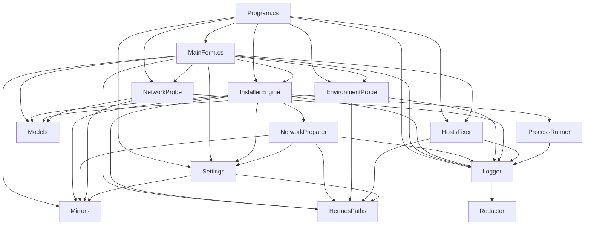

# Hermes Update — 项目技术地图

> 面向 agent 的项目速览。用户文档见 `README.md`。
> 本文件的结构与调用关系由 `codegraph` 索引实测得出（14 个 C# 文件 / 473 节点 / 1165 边）；改代码后先 `codegraph sync`，再回来核对。

## 1. 项目定位

Windows 平台的 **Hermes Agent / Hermes 桌面端** 安装与升级工具（非官方，社区维护）。
单文件 WinForms，目标框架 **.NET Framework 4.8**（Win10/11 自带，无需额外运行时）。

## 2. 技术栈

| 项 | 值 |
|---|---|
| 语言 | C#（csproj 为 `LangVersion=latest`，但现有代码实测全是 C# 5/6/7 风格：无 `$"..."` 插值、无 `?.`、无 `nameof`、无 record / switch 表达式；字符串一律 `string.Format` + 拼接——新代码照此风格写） |
| 目标框架 | `net48`（`src/HermesInstaller/HermesInstaller.csproj`） |
| UI | WinForms 单窗体（`MainForm.cs`） |
| 编译期引用 | `System.Web.Extensions`（`JavaScriptSerializer` 解析 install.ps1 的 JSON）、`System.Runtime.Serialization`（`DataContractJsonSerializer` 存配置）、`System.Net.Http` |
| 平台 | `AnyCPU`、`Prefer32Bit=false`、`CodePage=65001` |
| 构建 | `pwsh -File .\build\build.ps1`（内部 `dotnet build` → 拷 exe/config/README/LICENSE/NOTICE → `Compress-Archive` 打 zip；需 .NET SDK，实测 SDK 10 可构 net48） |
| 产物 | `dist/HermesInstaller/HermesInstaller.exe`、`dist/HermesInstaller-win-x64.zip` |
| 依赖 | 无第三方 NuGet；仅 BCL + PowerShell 子进程 |

## 3. 目录结构（括号内为 行数 / 符号数 / 被依赖文件数）

```
HermesInstaller.sln
build/build.ps1                    ← 构建 + 打包脚本
src/HermesInstaller/
  Program.cs            (200 行,  7 符号,  无上游)      ← 入口；TLS1.2/1.3、单实例 mutex、全局异常、--fix-hosts/--restore-hosts/--selftest（DPI 由 app.manifest 声明 PerMonitorV2，非代码设置）
  MainForm.cs           (1311 行, 91 符号, 被 Program)   ← 主窗体：UI 构建 + 事件 + 流程编排（约 51KB）
  HermesInstaller.csproj
  Resources/app.manifest, Resources/icon.ico
  Core/                            ← 业务内核，与 UI 解耦，改逻辑优先动这里
    InstallerEngine.cs  (581 行, 32 符号, 被 2 文件)     ← 安装/升级/卸载引擎，唯一调官方 install.ps1 的地方
    EnvironmentProbe.cs (476 行, 29 符号, 被 2 文件)     ← 环境探针（Win/x64/PS/磁盘/内存/长路径/.NET/既有安装/进程/管理员/代理/杀软/时间）
    ProcessRunner.cs    (250 行, 17 符号, 被 1 文件)     ← 子进程封装（超时/取消/流式输出/引号转义）
    HostsFixer.cs       (217 行, 13 符号, 被 2 文件)     ← hosts 备份/写入/还原（提权）
    Models.cs           (184 行, 84 符号, 被 5 文件)     ← 全部 DTO + 3 个枚举
    NetworkProbe.cs     (184 行,  9 符号, 被 2 文件)     ← 各镜像可用性与延迟探测
    Logger.cs           (165 行, 30 符号, 被 8 文件)     ← 日志：内存事件 + 落盘 + 汇总（耦合中心）
    Mirrors.cs          (120 行, 19 符号, 被 6 文件)     ← 官方端点 + 镜像候选默认值
    HermesPaths.cs      ( 91 行, 23 符号, 被 6 文件)     ← Hermes 安装路径推导（HERMES_HOME 可覆盖）
    Settings.cs         ( 90 行, 17 符号, 被 4 文件)     ← 配置持久化（DataContract JSON → %LOCALAPPDATA%\HermesInstaller）
    NetworkPreparer.cs  ( 80 行,  8 符号, 被 1 文件)     ← 镜像注入成环境变量，喂给子进程
    Redactor.cs         ( 61 行,  5 符号, 被 1 文件)     ← 日志脱敏，只被 Logger 调用（唯一收口点）
```

## 4. 分层与调用链

三层，**依赖单向向下**，Core 不反向依赖 UI：



关键路径（`codegraph callers/callees` 实测）：

- **一次操作的完整链路**
  `MainForm.RunOperationAsync(kind)` → `ConfirmOperation(kind)` → `ApplySettingsFromUi()` → `Settings.Save()` → `Logger.Start()` → `new InstallerEngine(settings, logger)` → `RunInstallAsync / RunUpgradeAsync / RunUninstallAsync`
- **真正干活的那一层**
  `InstallerEngine.RunStageAsync(stage, ...)` → `NetworkPreparer.BuildEnvironment()`（拼镜像环境变量）→ `ProcessRunner.RunPowerShellAsync()`（跑官方 `install.ps1 -Stage ... -NonInteractive -Json -Channel ...`）→ 从 stdout 取最后一行含 `"ok"` 的 JSON → `StageResult{Ok, Skipped, Reason}`；取不到 JSON 就退回用 exit code 判成败。
- **失败兜底**
  `RunOperationAsync` 捕获异常 → `OfferHostsFixAsync(failure)` → 仅当 `LooksLikeNetworkFailure(failure)` 为真且用户点「是」→ `FixHostsAsync()` → `HostsFixer.Apply()`（先 `TryBackup()` 备份再写 hosts）。
- **脱敏收口**
  所有日志最终走 `Logger.Write(level, msg)` → `Redactor.Redact(msg)`；`Redactor` 只有这一个调用方。

`InstallerEngine` 与 `MainForm` 三跳内**没有任何测试文件**——本项目零测试覆盖，改动只能靠真机冒烟验证。

## 5. 关键类型

### 5.1 枚举（3 个在 `Models.cs`，`LogLevel` 在 `Logger.cs`）

| 枚举 | 成员 | 用途 |
|---|---|---|
| `OperationKind` | `CliInstall` `CliRepair` `CliUpgrade` `CliUninstall` `DesktopInstall` `DesktopRepair` `DesktopUpgrade` `DesktopLaunch` | 8 种操作；`switch` 分发的唯一位置是 `MainForm.RunOperationAsync` |
| `ProbeStatus` | `Ok` `Warn` `Fail` `Info` | 环境探针每项状态，决定 UI 颜色与汇总计数 |
| `NetworkKind` | `Http` `GitRefs` | 探测方式：HTTP 请求 vs `git ls-remote` |
| `LogLevel` | `Info` `Warn` `Error` `Success` `Stage` | 日志级别（`Stage` 用于阶段标题） |

### 5.2 DTO（全在 `Models.cs`，均为 `public sealed class`）

| DTO | 关键成员 | 用途 |
|---|---|---|
| `ProbeItem` | `Name` `Status` `Message` | 单条环境探针结果 |
| `ProbeReport` | `Items` + `Ok/Warn/Fail` 计数 | 环境探针汇总，UI 表格数据源 |
| `NetworkEndpoint` | `Id` `Name` `Category` `Url` `Kind` `Required` | 待探测端点定义 |
| `NetworkResult` | `Endpoint` `Ok` `LatencyMs` `Error` | 探测结果，UI 表格数据源 |
| `OperationRequest` | `Kind` `IncludeDesktop` `SkipBrowser` `SkipComputerUse` | 一次操作的入参 |
| `OperationResult` | `Ok` `Skipped` `Reason` | 操作结果 |
| `ProgressInfo` | `Index` `Total` `Stage` `Message` `StageChange` | 进度条 + 状态文本 |
| `InstallStamp` | 已有安装的版本/时间戳 | 读既有安装信息 |
| `ManifestStage` | `Title` 等 | `install.ps1 -Manifest` 返回的阶段定义 |
| `InstallManifest` | `Stages` 等 | 安装清单，决定进度总步数 |

### 5.3 常量与路径

- `Mirrors`：官方端点 `OfficialInstaller` / `OfficialDownload` / `Github` / `GithubApi` / `RawGithub`；镜像 `ElectronMirror` / `BuilderMirror` / `NpmRegistry`（npmmirror）、`PipIndex`（清华源）；`RepoCandidates` = ghproxy.net → gh-proxy.com → 直连。`BuildEndpoints()` 把它们拼成待探测列表。
- `HermesPaths`：`HermesHome`（`HERMES_HOME` 优先，否则 `%LOCALAPPDATA%\hermes`）→ `InstallDir`=`hermes-agent`、`BinDir`=`bin`、`HermesCmd`=`bin\hermes.cmd`、`LogsDir`=`logs`、`InstallLog`、`BootstrapLog`、`InstallStamp`、`ConfigFile`、`DesktopExe`（`apps\desktop\release\win-unpacked\Hermes.exe`）、`DesktopReleaseDir`、`CliLauncherPresent`、`DesktopBuilt`。
- `Logger`：日志目录 `%LOCALAPPDATA%\HermesInstaller`，暴露 `Logged` 事件给 UI 实时刷日志。
- `HostsFixer`：备份到 `%LOCALAPPDATA%\HermesInstaller\hosts-backups\hosts.bak-*`（`RestoreLatestBackup` 取最新一份还原）；`Apply` 删除 hosts 里已有的 `github.com` / `raw.githubusercontent.com` 映射后**写入 3 条硬编码 IP**（`185.199.108.133`、`185.199.111.133` → raw.githubusercontent.com，`20.205.243.166` → github.com），再 `ipconfig /flushdns` + `/registerdns`。这些 IP 会过期——「修了 hosts 还是不通」先怀疑这里。
- 提权方式：app.manifest 是 `asInvoker`（平时不以管理员跑）；`MainForm.FixHostsAsync` 检测到非管理员时，用 `Application.ExecutablePath --fix-hosts` + `Verb=runas` 自提权重启一个自身进程，再由 `Program.RunHostsAction` 落地。
- `Settings` 的 12 个字段：`channel`（默认 `stable`）、`skipBrowser`、`skipComputerUse`、`autoDetectMirrors`（默认 `true`）、`repoMirror`、`electronMirror`、`builderMirror`、`npmRegistry`、`pipIndex`、`allowHostsFix`（默认 `false`）、`backupBeforeUpdate`、`lastOperation`。

## 6. 改动风险（codegraph impact 实测）

改这些符号前先算清波及面：

| 符号 | 受影响符号数 | 说明 |
|---|---|---|
| `Logger.Write` | 19 | 日志总入口。改签名波及 Logger 全部 7 个级别方法 + InstallerEngine 的 7 个方法 + `MainForm.RunOperationAsync` + `NetworkPreparer.BuildEnvironment` + `Program.RunHostsAction` |
| `Redactor.Redact` | 12 | 脱敏唯一收口，改正则影响全部日志出口 |
| `EnvironmentProbe.RunAsync` | 10 | 探针入口，影响 UI 首屏 |
| `NetworkPreparer.BuildEnvironment` | 10 | 镜像环境变量，改错会导致子进程拉不到包 |
| `Settings.Save` | 7 | 配置落盘 |
| `HostsFixer.Apply` | 4 | 唯一会改系统文件的方法，波及面小但风险最高 |

## 7. 关键约束（改代码前必读）

1. **语法风格保守**：csproj 虽是 `LangVersion=latest`，但 net48 缺少 record/init、`Index`/`Range`、可空引用类型所需运行时类型（`IsExternalInit` 等），且现有代码全是 `string.Format` + 拼接的老写法。**照抄现有风格**，别引入插值字符串或新语法糖。
2. **单文件发布**：目标是「解压双击即用」，不要引入需要额外安装的运行时或 NuGet 依赖。
3. **默认不动系统文件**：`HostsFixer` 只在「操作因网络失败 + 用户明确点确认」时触发（`OfferHostsFixAsync` 里 `LooksLikeNetworkFailure` 是第一道闸）；`Apply` 内先 `TryBackup()` 再写，任何改动必须可还原。
4. **日志脱敏不可绕过**：所有写日志路径必须走 `Logger.Write`，由它调 `Redactor`；别绕开 Logger 直接写文件。
5. **UI 与 Core 分离**：业务逻辑放 `Core/`，`MainForm.cs` 只做编排与展示——已 1311 行 / 51KB，别再往里堆业务。
6. **进程占用**：升级/卸载前必须停掉 `%LOCALAPPDATA%\hermes` 下的进程（`InstallerEngine.StopHermesProcessesAsync`），否则文件占用失败。
7. **改完必须过 `build.ps1` 编译**，再真机冒烟。

## 8. 构建与验证

```powershell
pwsh -File .\build\build.ps1        # 构建 + 打包
```

产物验证：`dist\HermesInstaller\HermesInstaller.exe` 能启动、环境探针跑完不崩。

本项目**无单元测试框架**（WinForms 强依赖系统环境），验证以**真机冒烟**为准：
启动 → 环境探针跑完 → 镜像探测有结果 → 选一个「新装/升级」走通 → 看日志无异常。

## 9. 常见坑

- `dotnet build` 直构 net48 需要 .NET Framework 参考程序集；`build.ps1` 已处理，别绕过它手工构。
- SDK 与 targeting pack 不匹配会报 `MSB3644`——用 `build.ps1` 走 SDK 的 reference assemblies 路径。
- 杀软误报 `uv.exe`（Hermes 自带），与本项目代码无关，但用户会来问——FAQ 已有条目，别改。
- `RunStageAsync` 靠「最后一行含 `"ok"` 的 JSON」判定阶段结果；官方 install.ps1 若改输出格式，会静默退化成只看 exit code。

## 10. 代码导航：用 codegraph，别全文搜

索引在 `.codegraph/`（SQLite WAL，约 1.5MB；自带 `.gitignore` 只保留自身，DB 不入库，但 `git status` 仍会显示 `?? .codegraph/`）。

```bash
codegraph status                # 索引是否最新
codegraph sync                  # 改完代码增量同步（先跑这个）
codegraph query "Installer"     # 按名字找符号
codegraph node <符号|文件路径>   # 源码 + 调用/被调链路（无需 read_file）
codegraph callers <符号>         # 谁调我
codegraph callees <符号>         # 我调谁
codegraph impact <符号>          # 改动影响面（改前必看）
codegraph explore "<自然语言问题>" # 一次性拉相关上下文 + 调用路径
```

## 11. Hermes 开发工作流（按需启用）

本项目配套了结构化交付工作流（七阶段：澄清→PRD→HLD/DD→拆卡派发→跟踪→验证→归档），资产在 `.hermes/`：

- **制度层**：`.hermes/Hermes制度层.md`（人格内核、七阶段流程、准入准出、派发规则、协商触发、编码委派规范）
- **模板库**：`.hermes/Hermes模板库/`（01 PRD / 02 HLD / 03 DD / 04 任务卡 / 05 会议纪要 / 06 进度报告 / 07 交付验证报告 / 08 看板卡片）

**适用判定**：查询、单点修复、改配置等快任务直接执行，不走流程；单模块功能裁剪走（澄清→任务卡→执行→验证）；仅多任务交付、需求有歧义或需合规追溯时才启用完整流程——启用时先读 `.hermes/Hermes制度层.md`，产出结构化文档前先读对应模板全文。用户说"走全流程"时强制启用，说"直接改"时强制跳过。

**项目红线优先**：本文件已有章节的技术事实与本节工作流冲突时，技术事实优先。
