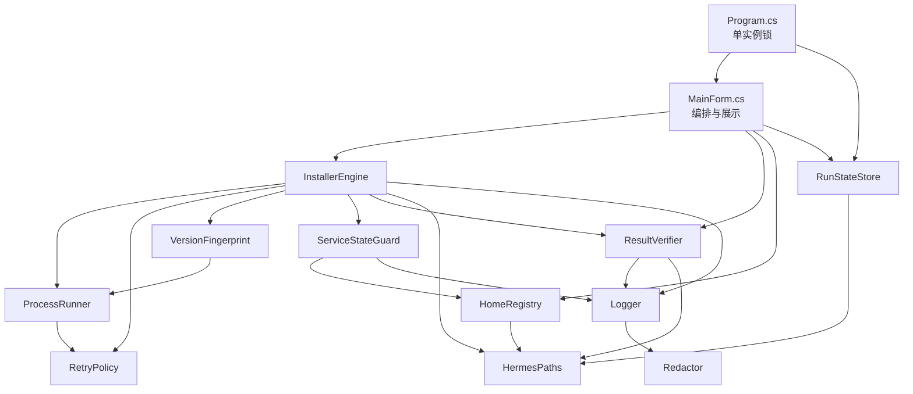

# HLD：Hermes Agent Windows 安装/升级工具 —— M1 结论可信化与超时治理（概要设计）

| 字段 | 内容 |
|------|------|
| 文档版本 | v1.0 |
| 关联 PRD | `doc/PRD_Hermes_Agent_Windows_升级工具_v1.5.md`（v1.5，已评审通过，2026-10-24） |
| 设计负责人 | Hermes |
| 评审状态 | 待评审（芦哥） |
| 本轮范围 | PRD §9.1 锁定 M1 七条 FR：FR-1.1 / FR-1.2 / FR-1.3 / FR-1.6 / FR-1.7 / FR-2.5 / FR-2.8 |
| 涉及代码 | `src/HermesInstaller/`（net48 单文件 WinForms，Core 分层；14 个 `.cs` / 3,996 行） |

**版本历史**

| 版本 | 日期 | 修改人 | 修改说明 |
|------|------|--------|----------|
| v1.0 | 2026-10-24 | Hermes | 初稿：M1 七条 FR 的组件划分、C# 接口冻结、风险与验证方案 |

---

## 1. 设计概述

### 1.1 设计目标

对齐 PRD §2.1 五条总目标，本轮只承担其中与 M1 相关的部分：

| PRD 目标 | 本轮承担部分 | 不承担 |
|---|---|---|
| §2.1-1 结论可信 | FR-1.1 四项断言 + 三元组结论；FR-1.7 服务复原（断言④的落地手段） | FR-3.3 全量自检表（M4） |
| §2.1-2 时间可控 | FR-1.3 超时载体 + FR-2.8 参数表（对本轮实际执行的子进程生效）+ NFR-01 总预算 | FR-4 换源（M2）→ **本轮只能「中止」，不能「切级」**，见 §8 R-01 |
| §2.1-3 跨机器可复制 | FR-2.5 幂等（重复点不产生副作用）；FR-1.6 多数据根识别 | FR-2.2 / FR-2.9 全量路径收口（M3，本轮只解决数据根枚举） |
| §2.1-4 失败可恢复 | FR-1.7 服务状态复原 | FR-2.3 状态机 / FR-2.4 回滚（M3） |
| §2.1-5 网络分级明确 | 无（M2 范围） | 全部 |

### 1.2 设计约束（硬约束，不可谈判）

| # | 约束 | 来源 | 对本设计的实际影响 |
|---|---|---|---|
| C1 | net48 + WinForms，单文件免安装，**不引入第三方 NuGet** | 项目 AGENTS.md §7.2 / PRD NFR-10 | 无 Newtonsoft / 无 Polly / 无 System.Threading.Tasks.Extensions；JSON 只用 `DataContractJsonSerializer` + `JavaScriptSerializer` |
| C2 | C# 5/6/7 风格：`string.Format`，**禁用插值 / `?.` / `nameof` / record** | AGENTS.md §7.1 / PRD NFR-11 | 无 `?.` → 所有可空访问写成显式 `!= null` 判断 |
| C3 | 业务逻辑进 `Core/`，`MainForm.cs` 不得继续膨胀（已 1,310 行 / 52.6KB） | AGENTS.md §7.5 / PRD NFR-09 | **UI 侧新增代码总量上限：≤120 行，只允许新增方法，不得重排既有方法体** |
| C4 | 不替换官方 `install.ps1` 安装逻辑，只做编排/守卫/兜底 | PRD §2.2 | 超时与断言只能在「调用方」施加，不得改 install.ps1 / hermes.cmd |
| C5 | 所有写日志路径必须走 `Logger.Write`（由其调 `Redactor`） | AGENTS.md §7.4 | 新组件一律注入 `Logger`，不得自行 `File.AppendAllText` 写日志 |
| C6 | 系统级动作默认关闭、可还原；本轮唯一系统级动作是「重启进程」 | AGENTS.md §7.3 / PRD NFR-07 | FR-1.7 只做**已有进程的恢复**，不新增自启项、不写注册表、不改服务配置 |
| C7 | 无测试框架，验证以 `build.ps1` + 真机冒烟为准 | AGENTS.md §4 / PRD NFR-12 | 每个组件必须提供「可离线复现的验证命令」，否则无法验收（见 §8 验证方案） |

### 1.3 设计原则

| # | 原则 | 落实方式 |
|---|---|---|
| P1 | **向后兼容优先**：既有 6 处 `RunProcessAsync` 调用点、`OperationResult.Ok/Error` 的全部调用点，签名与语义保持不变 | 新能力一律用「新增重载 / 新增静态工厂 / 新增可选参数」，禁止改既有签名 |
| P2 | **单一收口**：同一件事只有一个入口 | 超时参数只在 `RetryPolicy`；结论判定只在 `ResultVerifier`；数据根枚举只在 `HomeRegistry`；进程状态快照只在 `ServiceStateGuard` |
| P3 | **不静默**：任何降级、跳过、兜底都要留日志 | 无进展杀进程必记 `[TIMEOUT]` 行；断言未过必记期望值与实测值；「忘记传超时」必记 `WARN` |
| P4 | **失败可解释**：错误消息含「谁、在哪一步、期望什么、实际什么」 | `OperationResult.Message` 必须带阶段名 + 期望值 + 实测值 |
| P5 | **不碰既有正确行为**：`StopHermesProcessesAsync` 现有按单根前缀匹配的正确部分保留，只做扩展 | DD 必须给「不改清单」逐行声明 |

### 1.4 复用调研结论（制度层 §7.4 硬要求）

| 待实现能力 | ①仓库内已有 | ②已有依赖可满足 | ③成熟库 | ④自研 | 结论 |
|---|---|---|---|---|---|
| 进程超时/终止 | `ProcessRunner.KillTree`（:204-235）已有杀树能力 | BCL `Process.WaitForExit(int)` | Polly（NuGet，违反 C1） | 自研轮询循环 | **自研**，复用现有 `KillTree`，不引库 |
| 无进展检测 | 部分：`Emit`（:195-202）已能转发每一行输出，缺时间戳 | BCL `Stopwatch` | — | 在 `Emit` 上加时间戳 | **扩展现有 `Emit`**，不新建管道 |
| JSON 存取 | `Settings`（DataContract）+ `JavaScriptSerializer` | — | Newtonsoft（违反 C1） | — | **复用 `Settings` 的存取模式**（先写 `.tmp` 再替换） |
| 进程枚举 | `EnvironmentProbe.FindHermesProcesses`（:314）已有按名 + 前缀匹配 | — | — | 扩展为按多根匹配 | **扩展现有方法**，不重写 |
| 版本信息 | `InstallerEngine.GetVersionAsync`（:380-406）已有 | — | — | — | **直接复用** |
| 结论三元组 | `OperationResult`（Models.cs:131-146）只有 bool | — | — | 加枚举 + 保留旧字段 | **扩展 `OperationResult`**，旧工厂零改动 |

---

## 2. 系统架构

### 2.1 架构选型及理由

**选型：沿用现有三层结构（入口层 / UI 层 / Core 业务层），新增组件全部落 `Core/`，不引入新进程、新服务、新线程模型。**

| 备选方案 | 描述 | 为何放弃 |
|---|---|---|
| A. 独立 Windows 服务 + IPC | 把编排做成常驻服务，UI 只做客户端 | 违反 C1「单文件免安装」：服务需注册、需管理员安装、卸载残留；且本轮范围只有 7 条 FR，收益远小于成本 |
| B. 引入 State Machine 框架（Stateless 等） | 用成熟状态机库表达阶段 | 违反 C1；且 M1 不要求完整阶段状态机（FR-2.3 属 M3），只要求幂等与结果判定 |
| C. **扩展现有 Core 分层（选定）** | 6 个新组件 + 4 处改造，全部在 `Core/`；UI 只加最薄的展示方法 | 复用现有 `Logger` / `ProcessRunner` / `Settings` 基础设施；打包体积不变（仍是单 exe）；`codegraph` 依赖关系可继续追踪 |

**理由补充**：现有 `Core/` 已有 12 个文件、依赖单向向下（AGENTS.md §4 实测无 Core → MainForm 反向依赖），扩展成本最低；`Logger`（8 个文件依赖）与 `HermesPaths`（6 个）已被验证为稳定的收口点，新组件沿用同一模式可保持架构一致性。

### 2.2 系统上下文图（C4 Level 1）

```
┌──────────────┐
│   芦哥       │  触发操作 / 确认提权 / 读取结论与日志
└──────┬───────┘
       │ WinForms UI
┌──────▼─────────────────────────────────────────────┐
│  HermesInstaller.exe（单文件，net48）               │
│  ┌───────────────────────────────────────────────┐ │
│  │ M1 新增/改造组件（全部在 Core/）               │ │
│  │  RetryPolicy · ResultVerifier · Fingerprint    │ │
│  │  HomeRegistry · ServiceStateGuard · RunState   │ │
│  └───────────────────────────────────────────────┘ │
└───┬──────────┬──────────┬──────────┬───────────────┘
    │          │          │          │
    ▼          ▼          ▼          ▼
┌────────┐┌────────┐┌─────────┐┌──────────────────┐
│hermes  ││install ││ 网关/   ││ %LOCALAPPDATA%   │
│.cmd    ││.ps1    ││ 桌面端  ││ \hermes          │
│(官方CLI)││(官方)  ││ 进程    ││ \HermesInstaller │
└────────┘└────────┘└─────────┘└──────────────────┘
     ↑ 只调用，不改动         ↑ 只读取/重启，不改配置
```

### 2.3 容器图（C4 Level 2）：Core 内部结构



**新增依赖边（codegraph 变更预告）**：`RetryPolicy` 将被 `ProcessRunner` + `InstallerEngine` 依赖（2）；`ResultVerifier` 被 `InstallerEngine` + `MainForm` 依赖（2）；`HomeRegistry` 被 `ServiceStateGuard` + `MainForm` 依赖（2）；`RunStateStore` 被 `Program` + `MainForm` 依赖（2）。改完后 `codegraph impact Logger.Write` 的 19 个受影响符号预计 +0（不改 Logger 签名）。

### 2.4 关键组件说明

| # | 组件 | 类型 | 职责 | 技术栈 | 承接需求 | 落点 |
|---|---|---|---|---|---|---|
| **G1** | `RetryPolicy` | **新增** | 9 类操作的超时/重试/退避参数表，纯数据 + 无状态查询 | C# 静态类 + 枚举 | FR-1.3、FR-2.8、NFR-01 | `Core/RetryPolicy.cs` |
| **G2** | `ResultVerifier` | **新增** | 操作结束前执行四项断言，产出 `VerificationReport` 与三元组结论 | C# + 异步 | FR-1.1、FR-1.7（断言④） | `Core/ResultVerifier.cs` |
| **G3** | `VersionFingerprint` | **新增** | 计算/比对「git HEAD + lock sha256 + CLI 版本」三元组指纹 | C# + `System.Security.Cryptography` | FR-1.2、FR-2.5 | `Core/VersionFingerprint.cs` |
| **G4** | `HomeRegistry` | **新增** | 枚举全部 Hermes 数据根，按根匹配进程并给出归属 | C# | FR-1.6 | `Core/HomeRegistry.cs` |
| **G5** | `ServiceStateGuard` | **新增** | 升级前快照网关/桌面端进程状态，收尾比对并复原 | C# + 进程 API | FR-1.7 | `Core/ServiceStateGuard.cs` |
| **G6** | `RunStateStore` | **新增** | 把「当前实例正在执行的阶段」落盘，供第二个实例读取展示 | C# + DataContract JSON | FR-2.5 | `Core/RunStateStore.cs` |
| **G7** | `ProcessRunner` | **改造** | 增加无进展超时 / 总超时 / 超时即杀树；`Emit` 记时间戳 | `Process` + `Stopwatch` | FR-1.3、FR-2.8 | `Core/ProcessRunner.cs`（249 行） |
| **G8** | `InstallerEngine` | **改造** | 编排层接入：升级前后指纹比对、升级前快照、收尾断言、按策略施加超时 | C# 异步 | FR-1.1、1.2、1.3、1.6、1.7、2.5 | `Core/InstallerEngine.cs`（580 行） |
| **G9** | `HermesPaths` | **改造** | 新增数据根候选列表（不改变现有 `HermesHome` 语义） | C# | FR-1.6 | `Core/HermesPaths.cs`（90 行） |
| **G10** | `MainForm` / `Program` | **改造（薄）** | 结论展示三元组；多根列表展示；锁被占时展示他人进度 | WinForms | FR-1.1、1.6、2.5 / NFR-09 | `MainForm.cs`、`Program.cs` |

---

## 3. 数据架构

### 3.1 数据模型

本轮无数据库，全部为本地 JSON 文件。三份文件均落在 `%LOCALAPPDATA%\HermesInstaller\state\`（**新增目录**，由 `HermesPaths.EnsureAppData()` 一并创建）。

| 实体 | 文件 | 字段 | 生命周期 | 承接需求 |
|---|---|---|---|---|
| `FingerprintRecord` | `state\fingerprint.json` | `SchemaVersion` / `GitHead` / `LockSha256` / `CliVersion` / `CapturedAt` | 每次升级前写；下次升级前读比对 | FR-1.2 |
| `RunStateRecord` | `state\run.json` | `SchemaVersion` / `Pid` / `Operation` / `StageName` / `StartedAt` / `HeartbeatAt` | 实例启动写、阶段切换更新、退出删除 | FR-2.5 |
| `ServiceSnapshot` | `state\service-snapshot.json` | `SchemaVersion` / `CapturedAt` / `Entries[]`（`HomePath` / `ProcessName` / `Pid` / `ExecutablePath`） | 升级前写，收尾读完即可（保留最近 1 份） | FR-1.7 |

### 3.2 数据流

```
[升级开始]
   │
   ├─► ServiceStateGuard.CaptureAsync() ──► service-snapshot.json
   ├─► VersionFingerprint.CaptureAsync() ─┐
   │                                      ├─► 与 fingerprint.json 比对
   │  读 fingerprint.json ────────────────┘        │
   │                                              ├─ 相等 → 跳过 update，直接进断言
   │                                              └─ 不等/无记录 → 执行 update
   ├─► RunStateStore.Begin(op) ──► run.json（每阶段 Heartbeat 更新）
   │
   ├─► ProcessRunner.RunProcessAsync(..., policy) ──► 超时则 KillTree + TimedOut=true
   │
   ├─► ResultVerifier.VerifyAsync() ──► VerificationReport（4 项）
   │
   ├─► ServiceStateGuard.RestoreAsync() ──► 比对 + 必要时重启
   │
   └─► 结论 = f(VerificationReport, ServiceRestore) → OperationOutcome
                                                       ├─ Success
                                                       ├─ Degraded（还原/降级成功但未达预期）
                                                       └─ Failed
```

### 3.3 存储方案选型

| 数据类型 | 存储选型 | 理由 | 备选方案 |
|---|---|---|---|
| 指纹 / 运行状态 / 服务快照 | `DataContractJsonSerializer` → 本地 JSON | 项目已有同模式（`Settings.cs`），零新依赖；人可直接阅读排障 | 注册表（不透明、需清理）、SQLite（多一个文件与锁） |
| 写入原子性 | 先写 `.tmp` 再 `File.Move` 覆盖 | 沿用 `Settings.Save()`（:66-87）已验证的模式，避免半写坏文件 | 直接覆盖（断电即坏） |
| 日志 | 沿用 `Logger`（UTF-8 无 BOM、AutoFlush） | AGENTS.md §7.4 唯一收口 | — |

---

## 4. 接口设计（S3 准出前冻结）

本工具无对外 HTTP 接口，**冻结点是 C# 内部接口**——任务卡照此实现，实现方不得自行改签名。

### 4.1 接口清单

| 编号 | 接口 | 方法 | 所属组件 | 对应需求 |
|---|---|---|---|---|
| API-01 | `RetryPolicy.For(OperationClass)` | 静态方法 | G1 | FR-1.3 / FR-2.8 |
| API-02 | `ProcessRunner.RunProcessAsync(..., ProcessRunOptions)` | 异步方法（新增重载） | G7 | FR-1.3 / FR-2.8 |
| API-03 | `ResultVerifier.VerifyAsync(bool includeDesktop, ServiceSnapshot baseline, CancellationToken)` | 异步方法 | G2 | FR-1.1 |
| API-04 | `VersionFingerprint.CaptureAsync(CancellationToken)` / `.Equals(FingerprintRecord, FingerprintRecord)` | 异步 + 静态 | G3 | FR-1.2 |
| API-05 | `HomeRegistry.Enumerate()` / `.MatchProcesses(List<HermesHomeInfo>)` | 静态 | G4 | FR-1.6 |
| API-06 | `ServiceStateGuard.CaptureAsync(CancellationToken)` / `.RestoreAsync(ServiceSnapshot, CancellationToken)` | 异步 | G5 | FR-1.7 |
| API-07 | `RunStateStore.Begin/UpdateStage/Heartbeat/ReadOther/Clear` | 同步（毫秒级） | G6 | FR-2.5 |
| API-08 | `OperationResult.Outcome`（新增字段）+ `OperationResult.Degrade(...)`（新增工厂） | 数据结构扩展 | Models | FR-1.1 |

### 4.2 关键接口定义（冻结）

#### API-01 / API-02：超时策略与进程执行

```csharp
// Core/RetryPolicy.cs
public enum OperationClass
{
    EndpointProbe, FileDownload, GitFetch, GitClone,
    NpmCi, UvSync, NodeGyp, Generic, OperationBudget
}

public sealed class ProcessRunOptions
{
    public OperationClass Class { get; set; }          // 用于日志与策略查询
    public TimeSpan? NoProgressTimeout { get; set; }    // null = 不检测（必记 WARN）
    public TimeSpan? TotalTimeout { get; set; }         // null = 不限制（必记 WARN）
    public int PollIntervalMs { get; set; }             // 默认 500
}

public static class RetryPolicy
{
    public static ProcessRunOptions For(OperationClass cls);           // 按 PRD FR-2.8 表返回
    public static TimeSpan BudgetFor(bool includeDesktop);             // CLI 25min / 桌面 40min
    public static int MaxAttempts(OperationClass cls);
    public static TimeSpan BackoffFor(OperationClass cls, int attempt); // 1s/2s/4s 等
}

// Core/ProcessRunner.cs —— 新增重载，旧签名保持不变
public Task<ProcessResult> RunProcessAsync(
    string fileName, string arguments, string workingDirectory,
    IDictionary<string, string> environment,
    Action<string, LogLevel> onLine,
    CancellationToken cancellationToken,
    string cleanupFile,                 // 保留原可选参数语义
    ProcessRunOptions options);         // 新增第 8 参数（重载，不给默认值以免误用）

public Task<ProcessResult> RunPowerShellAsync(
    string invocation, string workingDirectory,
    IDictionary<string, string> environment,
    Action<string, LogLevel> onLine,
    CancellationToken cancellationToken,
    ProcessRunOptions options);         // 新增重载
```

`ProcessResult` 扩展（保留既有 4 个属性）：

```csharp
public bool TimedOut { get; set; }        // 超时被杀
public string TimeoutKind { get; set; }   // "no-progress" | "total" | null
public long ElapsedMs { get; set; }
public long LastOutputAgoMs { get; set; } // 超时时刻距最后一次输出
```

#### API-03：结果断言

```csharp
public enum AssertionStatus { Pass, Warn, Fail, Skipped }

public sealed class AssertionItem
{
    public string Name { get; set; }        // 断言名（中文，给 UI 用）
    public string Expected { get; set; }
    public string Actual { get; set; }
    public AssertionStatus Status { get; set; }
    public string Detail { get; set; }
}

public sealed class VerificationReport
{
    public List<AssertionItem> Items { get; }
    public OperationOutcome Outcome { get; }   // 由四项综合：全 Pass=Success；有 Warn 无 Fail=Degraded；有 Fail=Failed
    public string Summary { get; }             // 一行中文结论，带失败项名称
}

public sealed class ResultVerifier
{
    public ResultVerifier(Logger logger, InstallerEngine engine);  // 复用 engine 的 GetVersionAsync
    public async Task<VerificationReport> VerifyAsync(
        bool includeDesktop, ServiceSnapshot baseline, CancellationToken ct);
}
```

四项断言（**口径冻结**）：

| # | 断言 | 判据 | 失败级别 |
|---|---|---|---|
| A1 | CLI 版本可取 | `hermes --version` 返回非空且匹配 `^v?\d+\.\d+` | Fail |
| A2 | 关键依赖可导入 | `python -c "import openai"` 退出码 0（openai 是本次日志中反复失败的依赖，见 PRD E1） | Fail |
| A3 | 桌面端产物存在（仅 `includeDesktop`） | `HermesPaths.DesktopBuilt` 为真 **且** `Hermes.exe` 的 `LastWriteTime` 晚于本次操作开始时间（解决 PRD 指出的「不校验是否本次产出」） | Fail |
| A4 | 服务状态不劣于升级前 | 见 §4.2 API-06 的 `RestoreAsync` 结果；未复原成功则 Fail | Fail |

> **A3 的「本次产出」判据是本 HLD 新增的设计点**：PRD §9.2 指出 `InstallerEngine.cs:312` 现以 `File.Exists` 判定「桌面端已随更新重建」，无法区分旧产物。此处改为 mtime 比较，操作开始时间由 `InstallerEngine` 记录后传入。

#### API-05：多数据根枚举

```csharp
public sealed class HermesHomeInfo
{
    public string Path { get; set; }
    public string Kind { get; set; }        // "HERMES_HOME" | "LOCALAPPDATA" | "USERPROFILE"
    public bool Exists { get; set; }
    public bool IsSelected { get; set; }    // 当前生效根
    public string CliVersion { get; set; }
    public List<ProcessRef> Processes { get; }
}

public static class HomeRegistry
{
    public static List<HermesHomeInfo> Enumerate();          // 去重后的全部根，顺序固定：HERMES_HOME → LOCALAPPDATA → USERPROFILE
    public static void MatchProcesses(List<HermesHomeInfo> homes);  // 按可执行文件路径前缀归属
}
```

**候选根与优先级（冻结）**：`HERMES_HOME`（若设）→ `%LOCALAPPDATA%\hermes` → `%USERPROFILE%\.hermes`。**三者路径去重**（`HERMES_HOME` 常等于后两者之一），去重后按顺序返回。`IsSelected` 只标记 `HermesPaths.HermesHome` 命中的那一个。

#### API-06：服务状态快照与复原

```csharp
public sealed class ServiceEntry
{
    public string HomePath { get; set; }
    public string ProcessName { get; set; }
    public int Pid { get; set; }
    public string ExecutablePath { get; set; }
    public bool WasRunning { get; set; }
}

public sealed class ServiceSnapshot
{
    public DateTime CapturedAt { get; set; }
    public List<ServiceEntry> Entries { get; }
    public bool HadGateway { get; }        // 快照时是否有网关进程
    public bool HadDesktop { get; }        // 快照时是否有桌面端进程
}

public sealed class ServiceStateGuard
{
    public ServiceStateGuard(Logger logger);
    public Task<ServiceSnapshot> CaptureAsync(CancellationToken ct);
    public Task<ServiceRestoreResult> RestoreAsync(ServiceSnapshot baseline, CancellationToken ct);
}

public sealed class ServiceRestoreResult
{
    public bool Restored { get; set; }
    public string Detail { get; set; }     // 「网关已重启（PID n）」「网关未运行过，无需恢复」等
}
```

**复原方式（冻结，2026-10-24 本机实测确认，非推测）**：

| 动作 | 命令 | 本机实测（2026-10-24） |
|---|---|---|
| 状态查询 | `hermes gateway status` | 输出两行：`✓ Scheduled Task registered: Hermes_Gateway` / `✓ Gateway process running (PID: 20860)` |
| 恢复运行时（**首选**） | `hermes gateway ensure` | help 原文：「Ensure a local runtime **without installing or replacing a service**」 |
| 启动已注册服务 | `hermes gateway start` | help 原文：「Start the installed systemd/launchd background service」；**Windows 上实为计划任务 `Hermes_Gateway`**，不是 systemd |

- 判定「网关在跑」：`gateway status` 的 ExitCode==0 **且**输出含 `Gateway process running`；
- 复原顺序：`ensure` → 复查 status 仍无进程则 `start` → 仍无则返回 `Restored=false` 并附 status 原文；
- **禁止**用 `Process.Start(DesktopExe)` 冒充「网关已恢复」；
- `gateway status` 的输出格式若变化（解析不到关键字），按 `Restored=false` 处理并**保留原文进日志**，不做正则硬猜。

#### API-07：运行状态落盘

```csharp
public sealed class RunStateStore
{
    public RunStateStore();                                  // 固定路径 %LOCALAPPDATA%\HermesInstaller\state\run.json
    public void Begin(string operation);                     // 写 Pid/Operation/StartedAt
    public void UpdateStage(string stageName);               // 阶段切换
    public void Heartbeat();                                 // 每 10s 一次（由 InstallerEngine 在阶段循环里调）
    public RunStateRecord ReadOther();                       // 读另一个实例留下的状态（锁被占时用）
    public void Clear();                                     // 正常退出删除
    public bool TryReadStale(TimeSpan maxAge, out RunStateRecord record);  // 心跳超时判定为陈旧
}
```

#### API-08：结论三元组（向后兼容扩展）

```csharp
public enum OperationOutcome { Success, Degraded, Failed }

public sealed class OperationResult
{
    public bool Success { get; set; }              // 保留：= (Outcome == Success)，旧调用点零改动
    public OperationOutcome Outcome { get; set; }  // 新增
    public string Message { get; set; }
    public string LogPath { get; set; }
    public VerificationReport Verification { get; set; }  // 新增：结论页展示用

    public static OperationResult Ok(string message, string logPath = null);        // 保留，内部置 Outcome=Success
    public static OperationResult Error(string message, string logPath = null);     // 保留，内部置 Outcome=Failed
    public static OperationResult Degrade(string message, string logPath = null);   // 新增，Success=false
}
```

### 4.3 第三方接口依赖

| 第三方 | 用途 | 版本 | 风险 |
|---|---|---|---|
| `hermes.cmd`（官方 CLI） | `--version` / `update --yes` / `desktop --build-only` / `gateway start`（探测） | 随安装变化 | **子命令可能不存在或改名**；`gateway start` 未在本次证据中确认存在 → 见 §4.2 兜底 |
| `install.ps1`（官方脚本） | 安装/修复的阶段协议 | 随官方变化 | 输出格式变化会静默降级为「只看退出码」（AGENTS.md §9 已知坑） |
| `python.exe`（Hermes 工具库） | A2 断言 `import openai` | 3.14.x | 工具库版本随 PM 更新；若 `openai` 不在依赖中，A2 会误报 → **DD 需给出「仅当升级前该依赖可导入才断言」的前置条件** |

---

## 5. 技术选型

| 领域 | 选型 | 理由 | 备选方案 |
|---|---|---|---|
| 语言/框架 | C# 5/6/7 风格 + net48 | 项目既有约束（C1/C2）；Win10/11 自带运行时，双击即用 | .NET 8 自包含（体积 +60MB，违背「单文件小体积」） |
| 异步模型 | `async/await` + `Task.Run` 包裹阻塞 `WaitForExit` | 与现有 `ProcessRunner` 一致；UI 线程不阻塞 | 纯线程 + 事件（改造面大，无收益） |
| 超时实现 | `WaitForExit(pollMs)` 轮询 + `Stopwatch` | BCL 原生；可同时实现总超时与无进展超时 | `CancellationTokenSource.CancelAfter`（只能做总超时，做不了无进展） |
| JSON 序列化 | `DataContractJsonSerializer` | 项目已有（`Settings`），零依赖 | `JavaScriptSerializer`（已用于 install.ps1 输出解析，但无 schema 约束） |
| 哈希 | `System.Security.Cryptography.SHA256` | BCL | — |
| 日志 | 既有 `Logger` + `Redactor` | C5 唯一收口 | — |

---

## 6. 部署架构

### 6.1 环境拓扑

无服务端、无多环境。单一 exe 在目标机运行：

```
构建机（本机）──build.ps1──► dist/HermesInstaller/HermesInstaller.exe (57 KB)
                                      │ 拷贝/解压
                                      ▼
                          目标机（Win10 1809+ / Win11, x64）
                          运行期写入：%LOCALAPPDATA%\HermesInstaller\
                                       ├─ logs\         （既有）
                                       ├─ cache\        （既有）
                                       ├─ run\          （既有）
                                       └─ state\        （本轮新增：fingerprint / run / service-snapshot）
```

### 6.2 部署策略

- **发布方式**：沿用 `pwsh -File .\build\build.ps1`（Release 构建 → `dist/` + zip）。
- **回滚方式**：替换回上一版 exe 即可（无注册表、无服务、无 GAC 依赖）；`state\` 下文件格式带 `SchemaVersion`，旧版读到更高版本号时**忽略并重建**（不报错）。
- **本轮的部署影响**：新增 `state\` 目录；`HermesPaths.EnsureAppData()` 需一并创建。

---

## 7. 安全设计

### 7.1 认证鉴权

不适用（本地单机工具，无网络服务）。

### 7.2 数据安全策略

| 项 | 设计 |
|---|---|
| 日志脱敏 | 所有新组件注入 `Logger`，不自行写文件；`Redactor` 现有 7 条规则覆盖 key/value、`sk-`、`ghp_`、`xox?`、`AKIA/ASIA`、`Bearer` |
| 不进日志的内容 | 进程 `ExecutablePath` **可以**进日志（排障必需）；`HERMES_HOME` 路径可以；**不得**记录任何 token/password/凭据（本轮不涉及） |
| 状态文件内容 | 只含路径、版本号、PID、时间戳、sha256 摘要；**不含**配置内容与任何密钥 |
| 系统级修改 | 本轮只有「重启进程」，且只在「升级前在跑」的前提下执行（C6）；不写注册表、不改服务、不自启 |
| 提权 | 本轮**不需要**管理员权限（FR-3.4 提权修复属 M4） |

### 7.3 失败可见性（防「假成功」的最后一环）

`OperationOutcome` 三元组必须一路传到 UI：
- `Success` → 绿色、`MessageBoxIcon.Information`
- `Degraded` → 橙色（`Color.FromArgb(191,96,0)`，与既有 Warn 配色一致）、`MessageBoxIcon.Warning`，消息首句为「降级完成：<原因>」
- `Failed` → 红色、`MessageBoxIcon.Error`

**禁止**在断言未全 Pass 时走 `OperationResult.Ok`（这是 PRD FR-1.1 的核心，也是 E2 根因）。

---

## 8. 关键技术风险

| # | 风险点 | 影响 | 验证方案（如何提前证明可行） | 兜底方案（失败怎么办） |
|---|---|---|---|---|
| **R-01** | **M1 无法做「换源」**：FR-1.3 要求「超时切级」，但 FR-4 的分级网络属 M2。M1 只能中止 | AC-04 在本轮只能部分满足（「900s 内中止」✅ /「切级」❌） | 在 DD 的验收条目里显式标注「AC-04=部分覆盖（中止✅/切级→M2）」，并在交付报告里列明 | 中止后给出明确指引：「已中止，请在 M2 交付后启用自动换源，或手动切换镜像后重跑」 |
| **R-02** | **无进展检测对 `hermes update` 是粗粒度的**：M1 编排是「一条 `hermes update --yes` 子进程」，内部 uv/npm 的进度只看得到 stdout 行 | 若 uv 卡住但 hermes 仍在打印心跳行，无进展检测不触发 | 用真实 uv 黑洞场景复现：`UV_INDEX_URL` 指向不可达地址，观察是否在阈值内被杀（AC-04 手法） | 双保险：无进展超时（180s）+ 总超时（CLI 25min），任一命中即杀树；杀后明确报「超时中止」 |
| **R-03** | ~~`gateway start` 子命令未经证据确认~~ → **已消除（2026-10-24 实测）**：`hermes gateway` 具备 `run/ensure/start/stop/restart/status/install/uninstall/list` 全套子命令，`status` 输出可解析 | 已无此风险 | 已实测，见 §4.2 API-06 表 | `ensure` 失败再退 `start`，两者皆失败则 `Restored=false` + 结论降级 |
| **R-10** | **`gateway ensure` 与已注册计划任务可能双起**：本机已注册计划任务 `Hermes_Gateway`，`ensure` 会不会另起一个进程未经验证 | 可能出现两个网关进程、端口冲突 | 派发卡内要求：先 `status` 记录原 PID，复原后再次 `status` 比对 PID 是否变化；不得只凭 ExitCode 判定 | 若发现双起，`Restored=false` 并保留两次 status 原文；**不主动 kill 计划任务拉起的进程**（那是系统级动作，超出本轮授权） |
| **R-11** | **A2 依赖断言的实际可导入性未验证**；本机 `pm/lock.json` 实测为 `{schema:1, packages:{bws, chromium, cua-driver, …}}`，**是 PM 组件清单（浏览器/chromium/cua-driver），不是 Python 包清单** | 若按 PRD 字面「关键依赖可导入」断言 `import openai`，可能与实际安装不符 → 误报 Failed | 派发前实测 `python -c "import openai"` 在本机工具库下的结果，把结论写进任务卡；断言口径改为「操作前可导入才断言」（见 R-04） | 不可导入则 A2 记 `Skipped`，不计入失败 |
| **R-04** | **A2 断言（`import openai`）可能误报**：不是所有安装都装 openai | 结论被误判为 Failed | 前置条件：只在「操作前该依赖可导入」时才断言；操作前不可导入则记 `Skipped` 而非 Fail | 把断言结果分级：`Skipped` 不计入失败 |
| **R-05** | **`WaitForExit(timeout)` 的已知 .NET 行为**：超时返回后异步输出缓冲可能未清空 | 杀进程后 `StandardOutput` 可能丢尾部，影响错误归因 | DD 里写死：超时判定后先 `KillTree`，再调一次无参 `WaitForExit()`（无限；因已杀进程必然很快返回）以清空缓冲，然后才取 `ExitCode` | 若仍丢尾部，日志已通过 `Emit` 实时落盘，排障不受影响 |
| **R-06** | **多根枚举的权限/异常**：`%USERPROFILE%\.hermes` 可能不可读，`MainModule` 可能对系统进程抛异常 | 枚举整体崩溃，阻塞升级主流程 | `HomeRegistry` 每个根独立 `try/catch`，失败只记 Warn 并跳过该根；`MatchProcesses` 沿用现有 `try{MainModule}catch{}` 模式 | 枚举失败不阻断主流程（只影响 UI 展示与 FR-1.7 精度），主流程用 `HermesPaths.HermesHome` 单根继续 |
| **R-07** | **UI 改动引发 NFR-09 违规**：结论页、多根列表、进度展示都要碰 `MainForm.cs` | `MainForm.cs` 从 1,310 行继续膨胀 | 在设计上把「结论文案生成」「多根列表数据」全部放 Core，UI 只做 `Text = xxx` 赋值；验收时用 `wc -l` 卡上限（DD 给出具体行数预算） | 若超预算，把 UI 展示抽成 `Core/UiTextBuilder.cs`（纯字符串拼装，可无条件放 Core） |
| **R-08** | **无测试框架**：所有断言逻辑只能真机验证 | 回归风险 | 每个组件都提供离线可复现命令（见 DD §6 测试设计）：黑洞端口、只读目录、双 home 构造 | 在 `Program --selftest` 里增加「断言与超时自检段」，使无需 GUI 也能验证（沿用既有自检机制） |
| **R-09** | **`state\` 文件与旧版共存**：用户从旧 exe 升级到新 exe 时无 `state\` 目录 | 首次运行报错 | `EnsureAppData()` 创建；所有读取走「文件不存在 → 返回 null → 走无记录分支」 | 任何 JSON 读失败都 `catch` 后返回 null（沿用 `Settings.Load` 的静默策略，但**记一条 Warn**，不静默） |

---

## 9. 评审记录

| 日期 | 参会人 | 结论 | 遗留问题 | 关联纪要 |
|------|--------|------|----------|----------|
| 2026-10-24 | 芦哥（需求方）、Hermes | 待评审 | R-01（AC-04 只能部分覆盖）、R-03（`gateway start` 待实测）需芦哥知悉 | 本表即决议记录 |
